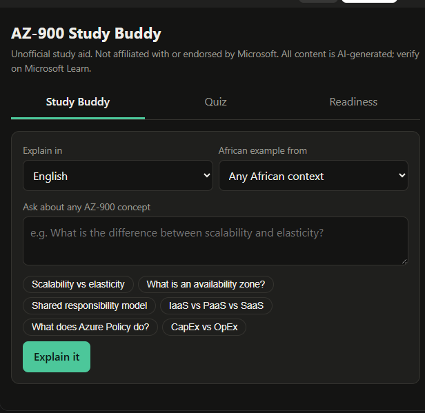

# AZ-900 Study Buddy (Unofficial)

> An AI study companion for Microsoft Azure Fundamentals (AZ-900) that explains cloud concepts with African examples and in local languages, writes original practice questions with explanations for every answer, and tracks your readiness by topic.

**Unofficial.** This project is not affiliated with, endorsed by, or sponsored by Microsoft. It uses no Microsoft logos and no real exam questions. All content is AI-generated from the public [AZ-900 skills outline](https://learn.microsoft.com/credentials/certifications/resources/study-guides/az-900) and should be verified on Microsoft Learn.

Built for the **#1MillionDevs AZ-900 Vibe Coding Hackathon** (20 to 23 October 2026) by [Chrystabel Young], solo.

**Live demo:** https://claude.ai/chat/b9af13fd-cb25-4942-afb7-a1c4fafcc8d8?artifact=58bddc7d-0678-432d-9ea4-bd0ca5ed65dd



## The problem

I kept failing the same elasticity vs. scalability questions because every definition sounded identical  "the ability to handle changing demand." What finally fixed it was thinking about a boda boda rider in Nairobi: scalability is buying a second bike because your regular customers doubled over the year; elasticity is calling in three riders for one chaotic Friday when a nearby office empties out at 5pm. The other thing that nearly broke me was practice tests telling me "Incorrect" with zero explanation so I started forcing myself to write one sentence on why I picked the wrong answer, and those notes did more for me than the tests themselves. By the end I wasn't sure I was ready, but I'd hit 85%+ across all four domains twice in a row, and that was the bar I trusted.


## What it does

This tool combines three of the hackathon tracks in one app.

| Tab | Track | What it does |
|---|---|---|
| Study Buddy | AI Study Buddy | Explains any AZ-900 concept in plain words, with an example from the learner’s chosen African context, in English, Swahili, Hausa, Yoruba, Zulu, French or Sheng, plus an exam tip. |
| Quiz | Smart Quiz Builder | Generates original questions by exam domain and subtopic. Every answer gets an explanation, and wrong answers get a note on the specific misconception. |
| Readiness | Readiness Tracker | Scores by domain, an overall estimate weighted by the exam’s domain weights, and the five weakest subtopics. “Target my weakest area” sends you back to them. |

## Prompt engineering

The prompts are the core of the product. Design choices:

1. **Role and audience fixed up front.** A beginner preparing for AZ-900, so explanations stay simple.
2. **Rigid structure.** Plain explanation, then one local analogy, then one exam tip, under 180 words. This keeps answers scannable and consistent.
3. **Honesty over fluency.** The model is told to say when it is unsure and point to Microsoft Learn rather than guess.
4. **Anti-copying guardrail.** Questions must be original and based only on the public skills outline.
5. **Machine-readable output.** The quiz prompt demands a strict JSON object (`question`, `options`, `answer`, `why`, `whyNot`, `tip`) so the UI can render feedback per option. Output is validated before display (exactly 4 options, integer answer index).
6. **Misconception-based feedback.** `whyNot` asks for the specific misconception behind each distractor, which is what turns a quiz into learning.
7. **Variety control.** The last six question stems are passed back in so questions do not repeat; the subtopic is chosen from the skills outline in code, not left to the model.
8. **Memoryless calls.** Each call carries its full instructions and context.

### Study Buddy prompt

```
You are "Study Buddy", a friendly tutor helping a beginner prepare for Microsoft Azure Fundamentals (AZ-900), based on the public AZ-900 skills outline.
Rules:
- Explain the concept in plain words first (2-4 sentences), then give ONE real-life analogy or example set in the learner's chosen African context, then a one-line "Exam tip" on how this is usually tested or confused with a similar concept.
- Be accurate about Azure. If you are unsure of a detail, say so and point to Microsoft Learn rather than guessing.
- Keep the answer under 180 words. No headings, no markdown symbols.
- Write in the requested language. Keep Azure service names in English.
- Never reproduce real exam questions.
```

### Quiz prompt

```
You write ORIGINAL practice questions for Microsoft Azure Fundamentals (AZ-900), based only on the public AZ-900 skills outline. Never copy or closely imitate real exam questions.
Return ONLY a JSON object, no markdown, with these keys:
"question", "options" (exactly 4), "answer" (0-3), "why", "whyNot" (one per option), "tip".
Be technically accurate. If a fact is uncertain, choose a different question.
```

## How readiness is calculated

Accuracy per domain, weighted by approximate exam weights (Cloud Concepts 27.5%, Architecture and Services 37.5%, Management and Governance 35%, midpoints of the published ranges). The estimate is only shown as reliable after 5 or more answers per domain. It is a study guide, not a prediction of your exam result.

## Tech

- Single-file HTML, CSS and JavaScript, no build step
- AI via Claude (Anthropic) through the claude.ai artifact runtime
- Progress stored in the browser’s `localStorage`, so there is no account and no server
- Built with Claude.ai as the AI pair-programmer

## Run it

Open the live demo link above. To run elsewhere, replace the `claude.use("sample")` calls in `index.html` with calls to your own LLM backend.

## Limitations (honest list)

- AI-generated questions can contain mistakes. Always check against Microsoft Learn.
- Language quality varies by language, and Swahili, Hausa, Yoruba and Zulu outputs deserve review by a native speaker.
- Progress lives in one browser and is not synced across devices.

## Roadmap

- Spaced-repetition flashcards from missed questions
- Study planner from exam date and weak areas
- Other certifications (AZ-104, AI-900, AWS Cloud Practitioner)
- Community-reviewed local-language glossary

## Repo layout

```
index.html   # the whole app
README.md
docs/        # screenshots
```
